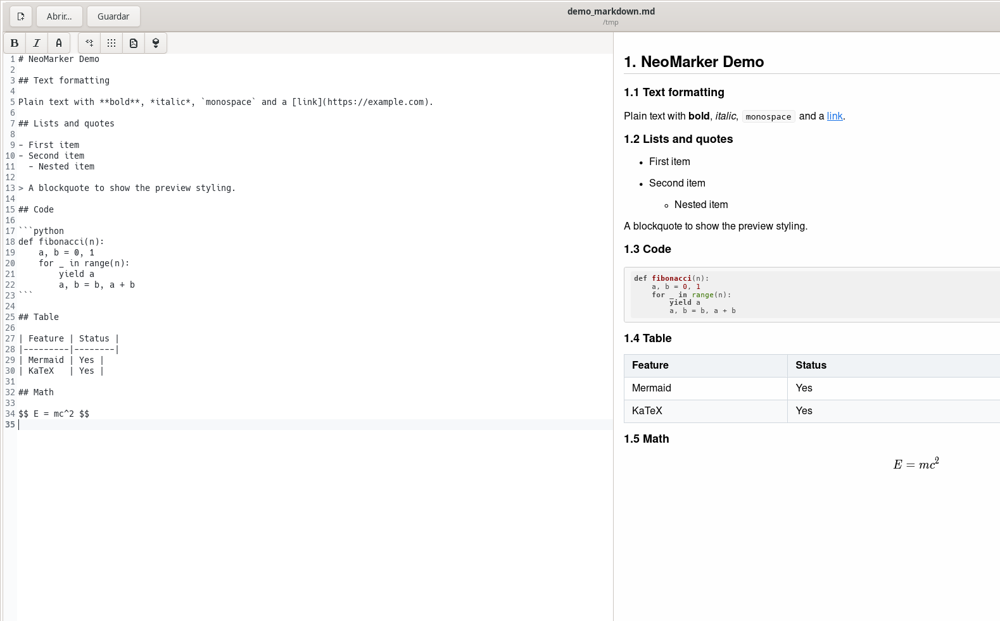
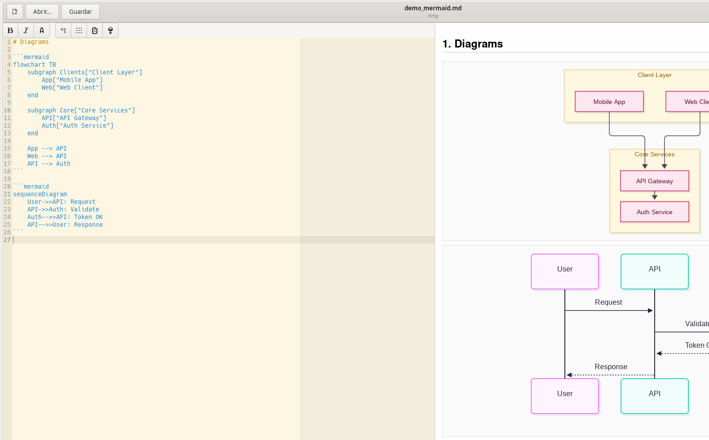

#  NeoMarker

A markdown editor for Linux made with GTK+-3.0. **NeoMarker is a fork of
[Marker](https://github.com/fabiocolacio/Marker)**, the original project by
[Fabio Colacio](https://github.com/fabiocolacio/Marker), and continues its
development independently.

NeoMarker exists because Marker development has stalled: upstream sees only
occasional commits, its Flathub package still builds against gtksourceview-3 and
needs network access to load Mermaid from a CDN. This fork keeps the editor
working on current distributions and fixes what broke.

[](https://github.com/alfonsodg/NeoMarker/actions/workflows/build.yml)

## Install

```bash
# Arch Linux
yay -S neomarker-bin     # prebuilt
yay -S neomarker-git     # from source
```

Any distribution:

```bash
# Self-contained AppImage — no dependencies needed
chmod +x NeoMarker-x86_64.AppImage && ./NeoMarker-x86_64.AppImage
```

Both come from the [latest release](https://github.com/alfonsodg/NeoMarker/releases/latest).

## What it gives you over upstream

- **Works today**: gtksourceview-4, no obsolete dependencies
- **Mermaid 12.2** configured like GitHub, so diagrams wrap their labels instead
  of stretching into a flat strip, plus a palette that separates containers from
  nodes in both the preview and the PDF
- **Mermaid highlighted inside the editor**, not just in the preview
- **Markdown syntax theme** with a colour per construct: headings, emphasis,
  inline code, links, list markers, quotes
- **Formatting toolbar**, labelled menu sections and a view-mode selector
- **Quick PDF** (`Ctrl+E`), batch export, merged output and beamer presentation
- **Security fixes**: shell injection removed from the export path, XSS
  restricted in the preview
- **No network permission needed**: Mermaid, KaTeX and highlight.js ship with the
  app instead of loading from a CDN

Marker is distributed under the [GNU General Public License v3](LICENSE.md).
NeoMarker inherits that licence and every derivative work keeps the same terms;
the original copyright notice is preserved in every source file.

> **Note** — NeoMarker is not affiliated with or endorsed by the Marker
> project. Bug reports about NeoMarker belong in
> [this repository](https://github.com/alfonsodg/NeoMarker/issues), not in
> upstream Marker.

## What's New (vs upstream)

### Security

- **RCE fix**: replaced `system()` with `g_spawn_sync()` to prevent shell injection
- **XSS fix**: Content Security Policy + WebKit JS restrictions in preview

### Updated Libraries

- **Mermaid 12.2.0** — configured exactly like GitHub, so diagrams wrap their
  labels instead of stretching into a flat strip. All diagram types: flowchart,
  sequence, class, state, ER, journey, gitgraph, mindmap, timeline, pie,
  quadrant, sankey, and more
- **KaTeX 0.16.21** — full LaTeX math rendering
- **Highlight.js 11.11.1** — syntax highlighting for 190+ languages
- **gtksourceview-4** — current editor widget, replacing the 3.x series

### Export and printing

- **Quick PDF** (`Ctrl+E`) — exports beside the source file with the same name,
  with an overwrite prompt and a result dialog that can open the folder
- **Export dialog** — PDF, HTML, LaTeX, RTF, ODT and DOCX, with format filters
  shown only when pandoc is available
- **Print** (`Ctrl+P`) — native print dialog with page setup
- **Presentation mode** — documents with a YAML `beamer` class are exported as
  slides: landscape, one slide per page, and the diagram sizing follows the
  slide area
- **Batch export** — a whole directory to PDF, optionally merged into one file

### CLI

```bash
neomarker file.md -o output.pdf          # export to PDF with Mermaid diagrams
neomarker /dir/ -b -o /output/           # batch export all .md files
neomarker /dir/ -b -o combined.pdf --merge  # merge into a single PDF
neomarker file.md -o output.pdf --watch  # re-export on every save
neomarker file.md -o output.pdf --landscape
neomarker file.md -o output.pdf --no-border
neomarker file.md -e | -p | -d | -w     # editor, preview, dual pane, dual window
```

### Editor

- **Formatting toolbar** — bold, italic, monospace, link, table, Mermaid and
  sketcher, with tooltips naming each accelerator
- **Search and replace** with Replace and Replace All
- **Outline sidebar** built from the document headings, click to jump
- **Scroll sync** between editor and preview, with a toggle to disable it
- **Drag and drop** images into the editor (png, jpg, gif, svg, webp)
- **Persistent zoom** per editor tab
- **Syntax highlighting** on by default, with a bundled light theme
- **Dark mode** for the whole interface and the preview, toggled from the menu
- **Emoji shortcodes**: `:rocket:` → 🚀, `:warning:` → ⚠️, `:white_check_mark:` → ✅

### PDF output

- **Page numbers** at the bottom of every page
- **Styled tables** with borders, striping, padding and fixed column widths
- **Headings kept with their tables** — no orphan headings at a page break
- **Diagram palette** separating container boxes from the nodes inside them
- **Syntax highlighting** colours preserved
- **Link URLs** shown in parentheses after link text
- **Heading numbering** (1. Title, 1.1 Subtitle) via YAML `numbering: true`
- **One diagram per page** in A4 format

### Code quality

- Memory leaks fixed (GObject dispose/finalize)
- Buffer over-reads fixed (null terminators)
- Test suite with 19 tests (`meson test`)
- CI/CD with GitHub Actions

## Features

### Editing features

- View and edit markdown documents with a live preview
- Four layouts: editor only, preview only, dual pane and dual window
- GtkSourceView editor with syntax highlighting, line numbers, right margin,
  auto indent, tab width and optional spaces-instead-of-tabs
- Find and replace, with Replace and Replace All
- Outline sidebar generated from the document headings; click an entry to jump
- Scroll sync from editor to preview, with a toggle
- Drag and drop images into the editor (png, jpg, gif, svg, webp)
- Persistent zoom level per editor tab
- Spell checking with language selection
- Sketch editor for drawing figures and inserting them inline

### Markdown support

- YAML front matter with document classes and metadata
- Beamer presentation mode: a `beamer` document class exports one slide per page
- Table of contents, equations, figures and cross-references
- TeX math through [KaTeX](https://katex.org/) or
  [MathJax](https://mathjax.org/)
- Diagrams with [Mermaid](https://mermaid.js.org/) — flowchart, sequence,
  class, state, ER, gantt, pie, mindmap, timeline, gitgraph and more — with
  automatic repair of common syntax mistakes
- Plotting with [charter](https://github.com/Mandarancio/charter/)
- Syntax highlighting in code blocks with
  [highlight.js](https://highlightjs.org/) (190+ languages)
- Emoji shortcodes such as `:rocket:` or `:white_check_mark:`

### Export formats

- Quick PDF beside the source file, with overwrite prompt and result dialog
- Export dialog for PDF, HTML, LaTeX, RTF, ODT and DOCX
- Print with the native dialog
- Batch export a directory of markdown files to PDF
- Merge a batch into a single PDF
- Watch mode: re-export whenever the source file changes
- Landscape orientation and borderless diagrams for wide content

### Appearance

- Custom CSS themes for the preview
- Syntax themes for the editor
- Dark mode for the interface and the preview
- Light and dark diagram palettes that separate containers from nodes

### Platform support

- Native GTK+3 application, translated into multiple languages
- Full command-line interface for scripted exports

## Screenshots

Dual pane with syntax highlighting, live preview, tables and math:



Mermaid diagrams and sequence diagrams, rendered with the same configuration
GitHub uses:



## Installation

### Arch Linux (AUR)

```bash
# Prebuilt binary (recommended, instant install)
yay -S neomarker-bin

# Build from source (compiles latest master)
yay -S neomarker-git
```

### Flatpak

```bash
# Build from manifest
flatpak-builder --install build io.github.alfonsodg.neomarker.yml
```

### AppImage

```bash
# Build portable AppImage
./build-appimage.sh
./NeoMarker-x86_64.AppImage
```

### From Source

#### Dependencies

- meson >= 0.37.0
- gtk3-devel >= 3.20
- gtksourceview4-devel
- webkit2gtk-4.1-devel
- gtkspell3-devel
- itstool
- pandoc (optional, for RTF/ODT/DOCX export)

#### Build

```bash
git clone https://github.com/alfonsodg/NeoMarker.git
cd NeoMarker
git submodule update --init --recursive
meson setup builddir
ninja -C builddir
meson test -C builddir
sudo ninja -C builddir install
```

## CLI Usage

```bash
# Open file in editor
neomarker document.md

# Export to PDF (with Mermaid diagrams)
neomarker document.md -o output.pdf

# Batch export entire directory
neomarker /path/to/docs/ -b -o /path/to/pdfs/

# Merge all into single PDF
neomarker /path/to/docs/ -b -o combined.pdf --merge

# Watch mode — re-export on every save
neomarker document.md -o output.pdf --watch

# Landscape orientation for wide diagrams
neomarker document.md -o output.pdf --landscape

# Export to HTML
neomarker document.md -o output.html

# Editor modes
neomarker document.md -e    # editor only
neomarker document.md -p    # preview only
neomarker document.md -d    # dual pane
neomarker document.md -w    # dual window
```

## Keyboard Shortcuts

### Documents

| Shortcut | Action |
| -------- | -------- |
| Ctrl+N | New document |
| Ctrl+O | Open document |
| Ctrl+Shift+O | Open document in a new window |
| Ctrl+S | Save |
| Ctrl+Shift+S | Save with a new name |
| Ctrl+W | Close document |
| Ctrl+Shift+W | Close window |

### Editing

| Shortcut | Action |
| -------- | -------- |
| Ctrl+B | Bold |
| Ctrl+I | Italic |
| Ctrl+M | Monospace |
| Ctrl+K | Insert link |
| Ctrl+T | Insert table template |
| Ctrl+Shift+M | Insert Mermaid diagram template |
| Ctrl+D | Open sketcher |
| Ctrl+F | Find and replace |

### View

| Shortcut | Action |
| -------- | -------- |
| Ctrl+R | Refresh preview |
| Ctrl+= | Reset preview zoom |
| Ctrl++ | Zoom in |
| Ctrl+- | Zoom out |
| F12 | Toggle outline sidebar |
| F11 | Toggle fullscreen |
| Ctrl+1 | Editor only |
| Ctrl+2 | Preview only |
| Ctrl+3 | Dual pane |
| Ctrl+4 | Dual window |

### Export

| Shortcut | Action |
| -------- | -------- |
| Ctrl+E | Quick PDF beside the file |
| Ctrl+P | Print |

### Window

| Shortcut | Action |
| -------- | -------- |
| Ctrl+Shift+N | New window |
| Ctrl+Q | Quit |

## Mermaid diagram repair

Hand-written Mermaid blocks often fail to render because of small syntax
mistakes. NeoMarker repairs the common ones before handing the block to
Mermaid, so the diagram appears instead of an error:

- A missing direction on `graph` or `flowchart` is filled in (`graph TD`)
- Unclosed quotes, `[` and `(` in node labels are closed
- Parentheses inside an edge label are removed — Mermaid's parser rejects
  `A -->|text (x)| B`
- CRLF line endings, a UTF-8 BOM and stray control characters are normalised

Only ` ```mermaid ` blocks are touched; every other fence and all surrounding
text pass through byte for byte.

Repair happens only when Mermaid rendering is enabled, so a document exported
with diagrams turned off is never altered.

## Credits and licence

NeoMarker exists because of [Marker](https://github.com/fabiocolacio/Marker):

- **Original project**: [Marker](https://github.com/fabiocolacio/Marker) by
  [Fabio Colacio](https://github.com/fabiocolacio), licensed under the
  [GNU General Public License v3](LICENSE.md)
- **Markdown engine**: [scidown](https://github.com/Mandarancio/scidown/) by
  Martino Ferrari
- **Plots**: [charter](https://github.com/Mandarancio/charter/) by Martino
  Ferrari
- **This fork**: [Alfonso de la Guarda](https://github.com/alfonsodg)

The GPL v3 requires derivative works to stay under the same licence and to
preserve the original notices. NeoMarker therefore keeps the original
copyright headers in every source file it inherited, states its origin in this
README and in the About dialog, and publishes all of its own source code under
the same terms.
